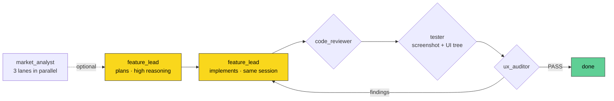

<div align="center">

### Orquestrador de Features

**A multi-agent loop that plans a React Native feature, writes it, opens the app on a real
Android device, and only then says whether it passed.**

Persistent-session agents · structured output · on-device evidence · Claude Code or Codex

[How it works](#how-it-works) · [Technical decisions](#technical-decisions) · [Flags](#flags) · [Task files](#registering-an-app)

</div>

---

You describe the change in one sentence. It decides whether the change is worth making,
closes the UX direction, writes the code, launches the app, takes a screenshot, reads the
UI tree, and reports back. If it did not pass, the findings go to the same developer
session — the one that still has the whole plan in context — and it tries again.

```bash
orquestrar-features --project ~/Documents/my-app "make the home screen calmer"
```

That is the whole interface. Everything below is what happens after you press enter.

> The CLI, the agent prompts and the task files are written in Brazilian Portuguese —
> that is the language this tool thinks in, and the transcript below is real output.
> The code, the commits and this document are in English.

```
-- configuracao ------------------------------------------------
Projeto    /Users/voce/Documents/meu-app
Provedor   Claude Code
Perfil     unattended
Config     meu-app
Tarefa     apps/meu-app/tarefas/hoje.md
Regras     34 linhas fixas
Mercado    context
Ciclos     3
Reasoning  design medium / codigo low
Android    com.exemplo.app
Gates      tela sempre · design sempre · ux sempre · codigo o brief decide
Credencial variável de ambiente
-- mercado: minerando avaliacoes reais -------------------------
mercado  COMPLETE abandono: motivo dominante é acúmulo visível
mercado  "In Todoist, if you miss a deadline, the task turns red
         and sits there glaring at you." - Todoist
-- capturando a tela atual antes de decidir --------------------
tela     estado atual capturado: 3 screenshot(s)
-- feature_lead: decidindo UX e direcao visual -----------------
lead     READY Hipótese confirmada: ATRASADAS aparece antes de HOJE
lead     mobile-design → design_director
-- ciclo 1: implementando --------------------------------------
lead     editando TodayScreen.tsx 41s
lead     FINISHED Seções reordenadas, contagem agregada removida
-- ciclo 1: auditando UX e aparencia ---------------------------
ux       CHANGES_REQUIRED Falta estado "em dia"
ux       [high] Lista vazia genérica -> Separar dos dois estados
```

---

## Why it exists

A single coding agent has two expensive problems.

**It rediscovers the project every time.** Separate sessions for planning, implementing
and reviewing each pay the toll of re-reading the app — tens of thousands of tokens
before any useful work starts.

**And it grades its own homework.** When the same model writes the code and judges it,
it defends what it just wrote.

The architecture answers both: **one heavy, persistent session** that plans and implements
without losing context, plus **separate, stateless specialists** fed with evidence the
Node process already computed — the diff, the screenshots, the UI tree. Separate so they
do not anchor on the author's reasoning; fed so they do not pay to rediscover the repo.

---

## How it works



`feature_lead` switches `reasoning` between planning and coding by **resuming the same
session id**. It is not a second agent and there is no written handoff: the design
decisions are still in the conversation when the code gets written. The specialists are
only created when the brief says they are needed.

Every agent answers with **structured output** against a JSON schema
([`src/schemas.js`](src/schemas.js)), so the loop branches on fields — `status`,
`worthBuilding`, `findings[].priority` — instead of parsing prose.

| Agent | Session | What it owns |
|---|---|---|
| `market_analyst` | stateless, 3 parallel lanes | Real user reviews: why people leave, why they stay, how they react to paying |
| `feature_lead` | **persistent** | The product call, the UX direction, the code, and every correction cycle |
| `code_reviewer` | stateless | The diff — correctness, structure, risk |
| `tester` | stateless | Screenshots and the UI tree from the device |
| `ux_auditor` | stateless | Flow, states, accessibility, visual direction |

---

## What it does differently

### It decides whether the work is worth doing

The brief answers `worthBuilding` — `yes`, `reduce` or `no` — with the reason. A `no`
ends the run before a single line of code is written. It comes back in the same turn as
the plan, so the decision costs no extra call.

### It mines real reviews, not feature tables

Knowing that a competitor has streaks, a widget and AI changes no decision — they all do.
What changes a decision is the reason, in the words of someone who used the thing:

> "In Todoist, if you miss a deadline, the task turns red and sits there glaring at you."

Three lanes run in parallel — **why they abandon**, **why they stay**, **how they react to
paying** — each signal carrying a literal quote, a source and a date. The research is
per app, not per feature, so it is cached and reused by every task.

### It validates on the actual screen

No "this should work". The driver launches the app, waits for the screen to **actually
render** (it polls the UI tree until any "Downloading…" is gone), runs deterministic
steps, and captures.

| Evidence accepted | Evidence rejected |
|---|---|
|  |  |
| Section expanded, list scrolled to the end | Bundle still loading — the tester blocks |

Steps navigate **by text**, never by coordinate, so they survive a layout change:

```json
[
  { "action": "wait", "ms": 2000 },
  { "action": "checkpoint", "name": "abertura" },
  { "action": "tapText", "value": "Sem prazo", "optional": true },
  { "action": "scrollToEnd", "times": 4 },
  { "action": "checkpoint", "name": "expandido" }
]
```

### It respects decisions that are already yours

`regras.md` holds the app owner's design invariants. They enter every planning turn as
things that **do not get reopened** — and if one of them blocks the task, the agent
reports it in `blockers` instead of overruling it.

That came from a real failure: the agent removed a section separator on its own
reasoning, and with nowhere to record the disagreement, the next run undid the fix.

---

## Two providers

The loop is provider-agnostic. `src/runtime-factory.js` picks a runtime, and both
implement the same surface: run an agent, resume a session id, set a reasoning effort,
return structured output.

| | Claude Code | Codex |
|---|---|---|
| SDK | `@anthropic-ai/claude-agent-sdk` | `@openai/codex-sdk` |
| Runtime | [`src/claude-agent.js`](src/claude-agent.js) | [`src/codex-agent.js`](src/codex-agent.js) |
| Continuity | session id | thread id |
| Reasoning | `low … max` | `minimal … persistent` |
| Auth | `ANTHROPIC_API_KEY`, `CLAUDE_CODE_OAUTH_TOKEN`, `~/.claude/.credentials.json`, or the macOS Keychain | `OPENAI_API_KEY` or `~/.codex/auth.json` |

```bash
orquestrar-features --project ~/Documents/my-app --provider claude "..."
orquestrar-features --project ~/Documents/my-app --provider codex  "..."
```

Adding a third provider means one more file implementing that surface and one more entry
in the factory — nothing in the loop, the agents or the schemas knows which one is running.

---

## Token economy

Every handoff is measured, not estimated.

| Where | What changed |
|---|---|
| Cycle 2 onwards | Only the findings travel. The contract is already in the resumed session |
| Reviewers | Receive the computed diff instead of re-exploring the repository |
| `tester` and `ux_auditor` | Only `uiNodes`, filtered errors and the screenshot paths |
| Specialists | `settingSources: []` — they do not load the project's CLAUDE.md |
| Market research | Cached per app, not per feature |

In one measured run, `market_analyst` accounted for **94.3%** of the tokens and
`feature_lead` for **5.7%**. That is why the market cache matters more than any reasoning
knob — and why `--marketing-mode none` is the right default for anything that is not a
product decision.

`--token-budget 800k` stops the run when the ceiling is reached, resumably.

---

## Install

Node 18+ and the CLI of the provider you plan to use (`claude` or `codex`), authenticated.

```bash
git clone <url> orquestrador-features
cd orquestrador-features
npm install
npm link
```

For the Android tester: `adb` on the PATH and a device or emulator running with the app
installed.

---

## Usage

Interactive, asking for profile, provider and Android package:

```bash
orquestrar-features
```

Straight to the point:

```bash
orquestrar-features --project ~/Documents/my-app "make the home screen calmer"
```

Diagnosis only, touching no file:

```bash
orquestrar-features --project ~/Documents/my-app "..." --plan-only
```

### Profiles

| Profile | Market research | Cycles | Gates |
|---|---|---|---|
| `fast` | off | 1 | screen only — iterate while you watch |
| `unattended` | on | 3 | screen, design and UX always — leave the house |
| `deep` | on | 5 | all four, high reasoning on design — auth, persistence, a new flow |

### Registering an app

So you do not repeat flags, `apps/<project-folder-name>/app.json`:

```json
{
  "provider": "claude",
  "profile": "unattended",
  "androidPackage": "com.example.app",
  "adbSteps": "adb/hoje.json",
  "competitors": ["Competitor A", "Competitor B"]
}
```

```
apps/my-app/
  app.json                      optional configuration
  regras.md                     design invariants that are never reopened
  tarefas/hoje.md               a recurring task
  tarefas/hoje.aceitacao.md     its acceptance criteria, matched by name
  adb/hoje.json                 the steps that reach the right screen
```

The project path is the key — no invented names. With no configuration at all, the run
works from whatever detection finds.

### Tasks that never touch the screen

A release build, a refactor or a README has nothing to look at, so `--no-screen-test`
drops the device driver and closes the screen, design and UX gates for that run — even
when the app config pins an Android package.

```bash
orquestrar-features --project ~/Documents/my-app --queue release-android-aab \
  --no-screen-test --marketing-mode none --code-reasoning high
```

### When it stops

Any run that does not end in `PASS` prints how to resume:

```
Retomar    orquestrar-features --resume runs/2026-08-31T15-43-22.json
```

`--resume` reuses the brief, the market research and the agent sessions, skipping planning
entirely. `--retries 0-5` resumes on its own — but only when there is a chance of
converging: missing evidence yes, a contradiction between the task and the rules no,
because repeating would spend again for the same answer. A provider usage limit is a
third case: it renews by itself, so the run waits instead of burning a retry.

### Two terminals at once

Every run takes a lock per project and per device. The second one refuses, naming who is
there:

```
Erro: Já existe uma execução em projeto-/Users/voce/Documents/meu-app:
pid 40457, desde 12:57:39 (0 min), tarefa: melhorar a tela de foco.
```

`--wait <minutes>` queues instead of refusing. A lock held by a dead process is detected
by pid and reclaimed.

The same wait covers the services: before starting, the run checks that the device shows
up in `adb devices` and that Metro answers on the port. A port held by something that is
not Metro is reported differently from Metro being absent, because the fix is different.

### Batch

```bash
orquestrar-features --project ~/Documents/my-app --tasks tasks.txt \
  --profile unattended --concurrency 3
```

Each task gets its own git worktree and an `orq/<slug>` branch. The device is serialized —
build, install and capture run one at a time — while planning, implementation and review
run in parallel. The result is a self-contained HTML report in `runs/`, screenshots
embedded.

### Sequential queue

```bash
orquestrar-features --project ~/Documents/my-app --queue login,groups \
  --profile deep --retries 2 --wait 60
```

For dependent features: the tasks run in order, **in the same working tree**, and each one
that ends `PASS` is committed before the next begins, so the second builds on the first's
real code. Names resolve like `--task-file`. The project must start clean; branch first if
you want to review everything in the morning. If one task stops, the queue stops, printing
its `--resume` and the `--queue` for what is left.

---

## Flags

`orquestrar-features --help` lists them all. The ones that matter most:

| Flag | What for |
|---|---|
| `--project <path>` | The app folder. It identifies everything else |
| `--task-file <name>` | A short name resolves the task and its acceptance criteria |
| `--plan-only` | Delivers the brief, writes no code |
| `--dry-run` | Prints the resolved configuration, spends zero tokens |
| `--profile <fast\|unattended\|deep>` | Market research, reasoning, cycles and gates at once |
| `--no-screen-test` | No device: for release, build, docs and refactor tasks |
| `--queue <names>` | Sequential queue with a commit between dependent tasks |
| `--tasks <file>` | Parallel batch, one worktree each |
| `--resume <state.json>` | Resumes a run that stopped |
| `--retries <0-5>` | Resumes on its own when that can converge |
| `--wait <minutes>` | Queue instead of refusal: locks, Metro and device |
| `--token-budget <n>` | Ceiling per run, `800k` / `1.5m`; stops resumably |
| `--escalation-model <id>` | A stuck agent gets one retry on a stronger model |
| `--marketing-mode <none\|context\|full>` | Market research depth |
| `--provider <codex\|claude>` | Which agent runs it |

---

## Technical decisions

**One persistent session for planning and coding.** The alternative — a planner agent
writing a document for an implementer agent — loses everything the planner learned but did
not write down, and pays to rediscover the repository. Resuming the same session with a
different reasoning effort keeps the design conversation in context while the code gets
written. The cost is that the author's bias is also still in context, which is exactly why
the reviewers are separate.

**Stateless reviewers, fed with computed evidence.** `code_reviewer`, `tester` and
`ux_auditor` never see the planning conversation. They receive the diff, the screenshots
and the UI tree that the Node process already computed. Separate so they judge the result
instead of the intention; fed so they do not spend tokens re-reading the repo.

**Structured output instead of prose parsing.** Every agent answers against a JSON schema.
The loop branches on `status` and `findings[].priority`; nothing depends on a model
phrasing a verdict the same way twice.

**Evidence before verdict.** The tester only judges after the screen is proven rendered.
A screenshot of a loading bundle is not evidence, and treating it as one produces a
confident, wrong PASS.

**Infrastructure failure is not feature failure.** A missing device, a dead Metro or an
adb timeout ends the run as `STOPPED` and resumable, never as `BLOCKED`. Only the loop's
own reasoning can block a feature.

**Retrying only when retrying can help.** `src/preflight.js` classifies why a run stopped.
Missing evidence is worth another capture. A contradiction between the task and
`regras.md` needs a human. A usage limit renews by itself, so it waits rather than
consuming a retry.

**The owner's rules outrank the agent's taste.** `regras.md` is loaded into every planning
turn as invariants. A rule that orders a fix can never be turned into a constraint that
preserves the thing it ordered fixed — a real regression the prompt now defends against
explicitly.

**Locks by resource, not by run.** One lock per project and one per device, held in
`runs/locks/` with the pid. Two terminals can work on two apps; they cannot fight over one
phone.

**Worktrees for parallelism, one working tree for dependencies.** A batch isolates each
task in its own git worktree so three features can be written at once. A queue does the
opposite on purpose: same tree, committed between tasks, because the second feature needs
the first one's real code.

---

## Development

```bash
npm test      # no network, no device
npm run check # syntax across every module
```

The tests cover the loop against a fake runtime, the resume classification, the
cross-process locks, the ADB step parser and the token trimming at each handoff. None of
them calls a model.

---

## License

MIT
