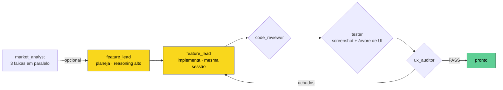
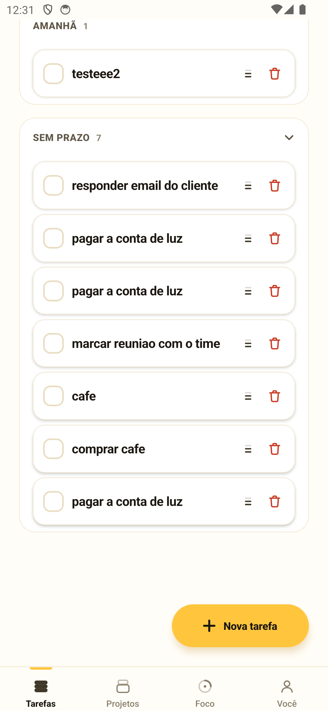
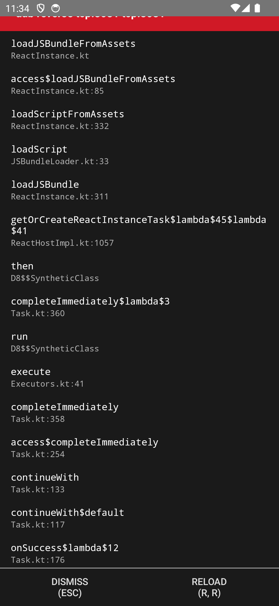

# Orquestrador de Features

Loop multiagente que planeja, implementa e **valida no device** uma feature de app
React Native — sem alguém olhando.

Você descreve a mudança. Ele decide se vale a pena, fecha a direção de UX, escreve o
código, abre o app num emulador Android, tira screenshot, lê a árvore de UI e só então
diz se passou. Se não passou, volta para o mesmo dev com os achados e tenta de novo.

Roda sobre **Claude Code** ou **Codex**, à sua escolha.

```
-- configuracao ------------------------------------------------
Projeto    /Users/voce/Documents/meu-app
Provedor   Claude Code
Perfil     unattended
Config     meu-app
Tarefa     apps/meu-app/tarefas/hoje.md
Regras     34 linhas fixas
Mercado    context
Ciclos     3
Reasoning  design medium / codigo low
Android    com.exemplo.app
Gates      tela sempre · design sempre · ux sempre · codigo o brief decide
Credencial variável de ambiente
-- mercado: minerando avaliacoes reais -------------------------
mercado  COMPLETE abandono: motivo dominante é acúmulo visível
mercado  "In Todoist, if you miss a deadline, the task turns red
         and sits there glaring at you." - Todoist
-- capturando a tela atual antes de decidir --------------------
tela     estado atual capturado: 3 screenshot(s)
-- feature_lead: decidindo UX e direcao visual -----------------
lead     READY Hipótese confirmada: ATRASADAS aparece antes de HOJE
lead     mobile-design → design_director
-- ciclo 1: implementando --------------------------------------
lead     editando TodayScreen.tsx 41s
lead     FINISHED Seções reordenadas, contagem agregada removida
-- ciclo 1: auditando UX e aparencia ---------------------------
ux       CHANGES_REQUIRED Falta estado "em dia"
ux       [high] Lista vazia genérica -> Separar dos dois estados
```

---

## Por que ele existe

Um agente de código sozinho tem dois problemas caros.

**Ele redescobre o projeto toda vez.** Sessões separadas para planejar, implementar e
revisar pagam o pedágio de reler o app a cada etapa — dezenas de milhares de tokens
antes de qualquer trabalho útil.

**E ele avalia o próprio trabalho.** Quando o mesmo modelo escreve e julga, ele defende
o que acabou de escrever.

A arquitetura aqui responde aos dois: **uma sessão pesada e persistente** que planeja e
implementa sem perder contexto, mais **especialistas separados e sem estado**,
alimentados com evidência que o processo Node já calculou — diff, screenshot, árvore de
UI. Separados para não ancorar; alimentados para não redescobrir.



O `feature_lead` troca de `reasoning` entre planejar e codar **retomando o mesmo ID de
sessão** — não é outro agente, não há handoff escrito. Os especialistas só nascem quando
o brief diz que são necessários.

---

## O que ele faz de diferente

### Julga se vale a pena antes de gastar

O brief responde `worthBuilding` — `yes`, `reduce` ou `no` — com o motivo. Um `no`
encerra o loop antes de escrever qualquer código. Sai no mesmo turno do planejamento,
então não custa uma chamada extra.

### Minera avaliação real, não tabela de features

Saber que o concorrente tem streak, widget e IA não muda decisão nenhuma — todos têm. O
que muda decisão é o motivo, na palavra de quem usou:

> "In Todoist, if you miss a deadline, the task turns red and sits there glaring at you."

Três faixas em paralelo — **por que abandonam**, **por que ficam**, **como reagem a
pagar** — com citação literal, fonte e data. A pesquisa é por app, não por feature: fica
em cache e alimenta todas as tarefas.

### Valida na tela de verdade

Nada de "acho que funciona". O driver abre o app, espera a tela **renderizar de fato**
(consulta a árvore de UI até sumir qualquer "Downloading…"), executa passos
determinísticos e captura.

| Evidência aceita | Evidência recusada |
|---|---|
|  |  |
| Seção expandida, lista rolada até o fim | Bundle ainda carregando — o tester bloqueia |

Passos navegam **por texto**, não por coordenada:

```json
[
  { "action": "wait", "ms": 2000 },
  { "action": "checkpoint", "name": "abertura" },
  { "action": "tapText", "value": "Sem prazo", "optional": true },
  { "action": "scrollToEnd", "times": 4 },
  { "action": "checkpoint", "name": "expandido" }
]
```

### Respeita decisões que já são suas

`regras.md` guarda invariantes de design do dono do app. Entram em todo planejamento como
coisas que **não se reabre** — e se uma delas impedir a tarefa, o agente reporta em
`blockers` em vez de contrariá-la.

Isso nasceu de um caso real: o agente removeu um separador de seção com justificativa
própria, e sem lugar para registrar a discordância, o run seguinte desfaria o conserto.

---

## Economia de token

Cada handoff é medido, não estimado.

| Onde | O que mudou |
|---|---|
| Ciclo 2 em diante | Só o feedback. O contrato já está na sessão retomada |
| Revisores | Recebem o diff pronto em vez de reexplorar o repositório |
| `tester` e `ux_auditor` | Só `uiNodes`, erros filtrados e caminho dos screenshots |
| Especialistas | `settingSources: []` — não carregam CLAUDE.md do projeto |
| Mercado | Cache por app, não por feature |

Num run real medido, `market_analyst` respondeu por **94,3%** dos tokens e o
`feature_lead` por **5,7%**. É por isso que o cache de mercado importa mais que qualquer
ajuste de reasoning.

---

## Instalação

Precisa de Node 18+ e do CLI do provedor que você for usar (`claude` ou `codex`)
autenticado.

```bash
git clone <url> orquestrador-features
cd orquestrador-features
npm install
npm link
```

Para o tester Android: `adb` no PATH e um emulador rodando com o app instalado.

---

## Uso

Modo interativo, que pergunta perfil, provedor e Android:

```bash
orquestrar-features
```

Direto, com o caminho do app:

```bash
orquestrar-features --project ~/Documents/meu-app "deixar a tela inicial mais calma"
```

Só o diagnóstico, sem tocar em arquivo:

```bash
orquestrar-features --project ~/Documents/meu-app "..." --plan-only
```

### Perfis

| Perfil | Mercado | Ciclos | Gates |
|---|---|---|---|
| `fast` | desligado | 1 | só tela — para iterar com você olhando |
| `unattended` | ligado | 3 | tela, design e UX sempre — para sair de casa |

### Apps registrados

Para não repetir flags, `apps/<nome-da-pasta-do-projeto>/app.json`:

```json
{
  "provider": "claude",
  "profile": "unattended",
  "androidPackage": "com.exemplo.app",
  "adbSteps": "adb/hoje.json",
  "competitors": ["Concorrente A", "Concorrente B"]
}
```

```
apps/meu-app/
  app.json                      configuração opcional
  regras.md                     invariantes de design
  tarefas/hoje.md               tarefa recorrente
  tarefas/hoje.aceitacao.md     critérios, casados pelo nome
  adb/hoje.json                 passos até a tela certa
```

O caminho do projeto é a chave — nada de nome inventado. Sem configuração, o app roda só
com o que a detecção descobre.

### Quando para

Toda execução que não termina em `PASS` imprime como retomar:

```
Retomar    orquestrar-features --resume runs/2026-08-31T15-43-22.json
```

`--resume` reaproveita brief, pesquisa de mercado e as sessões dos agentes, pulando o
planejamento inteiro. `--retries 0-5` retoma sozinho — mas só quando há chance de
convergir: falta de evidência sim, contradição entre a tarefa e as regras não, porque
repetir daria o mesmo resultado gastando de novo.

### Dois terminais ao mesmo tempo

Cada execução pega trava por projeto e por device. A segunda recusa dizendo quem está lá:

```
Erro: Já existe uma execução em projeto-/Users/voce/Documents/meu-app:
pid 40457, desde 12:57:39 (0 min), tarefa: melhorar a tela de foco.
```

`--wait <minutos>` entra na fila em vez de recusar. Trava de processo morto é detectada
pelo pid e reaproveitada.

### Lote

```bash
orquestrar-features --project ~/Documents/meu-app --tasks tarefas.txt \
  --profile unattended --concurrency 3
```

Cada tarefa ganha uma worktree git própria e um branch `orq/<slug>`. O device é
serializado — build, install e captura correm uma por vez, enquanto planejamento,
implementação e revisão seguem em paralelo. No fim sai um HTML autocontido em `runs/`
com screenshots embutidos.

---

## Flags

`orquestrar-features --help` lista todas. As que mais importam:

| Flag | Para quê |
|---|---|
| `--project <caminho>` | Pasta do app. É ela que identifica tudo o mais |
| `--task-file <nome>` | Nome curto resolve a tarefa e os critérios |
| `--plan-only` | Entrega o brief, não escreve código |
| `--dry-run` | Mostra a configuração resolvida, gasta zero token |
| `--profile <fast\|unattended>` | Mercado, reasoning, ciclos e gates de uma vez |
| `--resume <estado.json>` | Retoma um run que parou |
| `--retries <0-5>` | Retoma sozinho quando faz sentido |
| `--wait <minutos>` | Fila em vez de recusa quando há colisão |
| `--marketing-mode <none\|context\|full>` | Pesquisa de mercado |
| `--provider <codex\|claude>` | Qual agente executa |

---

## Desenvolvimento

```bash
npm test      # sem rede e sem device
npm run check # sintaxe de todos os módulos
```

Os testes cobrem o loop com runtime falso, a classificação de retomada, as travas entre
processos, o parser de passos ADB e o corte de tokens em cada handoff. Nenhum deles chama
modelo.

---

## Licença

MIT
